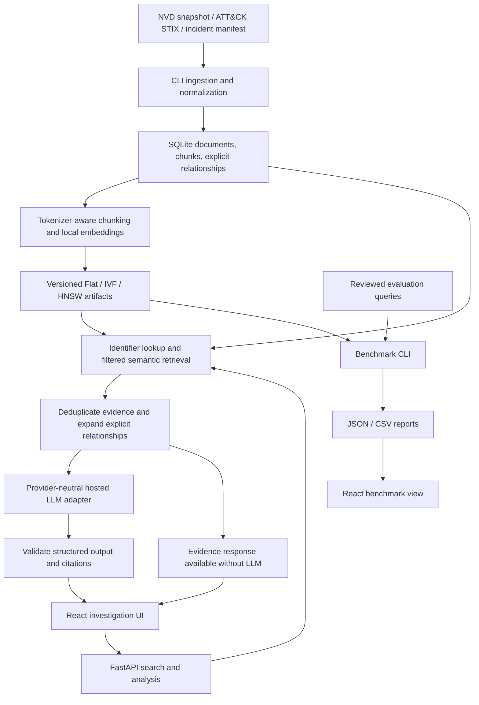

# ThreatVector build guide

This is the main architecture and implementation reference. `Requirements.md` defines acceptance criteria; `AGENTS.md` governs agent work; `Progress.md` records actual delivery state. This file describes intended behavior, not completed implementation.

## Architecture flow

## Components and storage

- **Frontend:** React, TypeScript, Vite, and Recharts. Investigation view shows query controls, ranked evidence, explanations, related entities, and mitigations. Evidence detail shows stored excerpts, metadata, and original links. Benchmark view compares actual quality, latency, and memory measurements.
- **Backend:** FastAPI with Pydantic validation; separate ingestion, embedding, index, retrieval, correlation, generation, and evaluation modules. Use pytest for backend checks and Vitest plus React Testing Library for meaningful UI behavior checks.
- **Metadata:** SQLite stores documents, chunks, and explicit relationships. Documents retain stable internal IDs, source type, source ID, title, URL, publication date when known, retrieval date, and content hash. Chunks retain document ID, ordinal, text, and token offsets. Relationships retain endpoints, relationship type, and the supporting source/chunk reference.
- **Artifacts:** Local data directories hold source snapshots, embeddings, indexes, manifests, and reports. Each index manifest records corpus/chunk hashes, model revision, vector dimension, metric, parameters, seed, and library versions. Write a new artifact set before making it active; never mix index generations.
- **Repository layout:** `backend/` contains Python services and CLI; `frontend/` contains the browser app; `data/` holds ignored local artifacts and separately tracked permitted fixtures/manifests; `evaluation/` holds reviewed questions and reports. Add a README, environment example, dependency locks, and ignore rules during scaffolding.

## Data and retrieval design

1. Ingest NVD CVE records from a bounded, recorded snapshot, a pinned MITRE Enterprise ATT&CK STIX release, and incident URLs listed in an explicit manifest. Select CVEs deterministically and record the selection in the manifest. Preserve raw source hashes; use pagination, bounded retries, and source rate-limit handling. Never silently substitute fixtures for a failed full import.
2. Normalize source-specific records, preserve ATT&CK relationships and explicit incident mentions of CVEs/techniques, and deduplicate by stable source identity and content hash. Exclude revoked/deprecated ATT&CK objects from active retrieval while preserving their provenance if referenced.
3. Use `sentence-transformers/all-MiniLM-L6-v2`, pinned to a verified revision. Chunk source sections into at most 220 model tokens with 30-token overlap, including any embedded title/metadata text within that limit. Produce normalized float32 embeddings locally on CPU. The model emits 384-dimensional vectors and truncates inputs above its documented limit: [model card](https://huggingface.co/sentence-transformers/all-MiniLM-L6-v2).
4. Construct FAISS `IndexFlatIP`, `IndexIVFFlat`, and `IndexHNSWFlat` with inner product. Flat is the default and exact comparison baseline. See [FAISS index documentation](https://github.com/facebookresearch/faiss/wiki/Faiss-indexes).
5. Build full-corpus indexes and source-type partitions. For multiple selected source types, search each selected partition and merge by comparable similarity score. Exact identifier matches precede semantic supplementation; deduplicate by chunk ID. Cap requests at 50 search results, defaulting to 10.
6. Expand explicit source relationships and retrieve their supporting chunks for analysis. Keep semantic associations labeled as inferred. Do not infer that a CVE was used in an incident merely because texts are similar.
7. Use up to eight deduplicated chunks for generation, prioritizing direct identifier evidence and supported relationships. Return insufficient evidence when nothing relevant survives a threshold calibrated on tuning queries; freeze that threshold before held-out evaluation. Do not interpret similarity scores as probabilities.

## API and generation contract

| Interface | Behavior |
| --- | --- |
| `GET /health` | Report service readiness, corpus/index availability, and provider configuration without revealing secrets. |
| `GET /corpus` | Return source counts, snapshot identity, and active artifact metadata. |
| `POST /search` | Accept `query`, `index` (`flat`, `ivf`, `hnsw`), `source_types`, and `top_k`; return ranked chunks, metadata, scores, and retrieval timing. |
| `POST /analyze` | Accept query, index, and source types; return status, cited claims, related entities, mitigations, evidence, and timing. |
| `GET /documents/{id}` | Return stored document metadata and chunks; return 404 for unknown IDs. |
| `GET /benchmarks` | Return saved benchmark runs and metrics; do not run expensive experiments inside an HTTP request. |

Validate nonblank queries with a 2,000-character cap and reject unknown enum values. Bind services to localhost and allow only the local frontend origin by default.

The provider interface is `generate(messages, response_schema)`. Implement a configurable OpenAI-compatible chat adapter with server-side endpoint, model, key, and a 60-second timeout. Provider-specific differences stay inside the adapter; provider-neutral does not mean every endpoint supports identical capabilities.

Require a structured response containing claims, related techniques/entities, mitigations, citation chunk IDs, and uncertainty. Every displayed factual claim and mitigation must have supporting evidence; explicitly labeled inference must also identify its basis. Validate response shape, citation membership in supplied context, and ATT&CK identifiers against the corpus. Retry invalid structured output once, then return evidence with a generation-error status. Missing credentials and timeouts also return evidence. Never replace failures with fabricated explanations.

Retrieved text is delimited untrusted evidence. It cannot set system instructions, request secret disclosure, or authorize tools. Generation has no tool execution capability. Validate traceability programmatically; assess actual entailment through answer evaluation.

## Benchmark protocol

- Use the same full-corpus embeddings and held-out queries for all indexes; keep filtered and identifier-assisted application results outside the ANN comparison.
- Sweep IVF `nlist=64/128/256` and `nprobe=1/4/16/32`; skip undertrained configurations with an explicit reason. Require at least 39 training vectors per centroid. Train with a fixed seed and a deterministic sample of up to 100,000 corpus vectors.
- Sweep HNSW `M=16/32`, `efSearch=16/64/128`, and `efConstruction=200`. Record build and search parameters independently.
- Fix seed 42 and use one FAISS search thread for the baseline. Warm up searches, then execute five timed passes; record hardware and versions. Embed queries before measuring index latency.
- Report recall@10 versus Flat, document-level relevance recall@10 and MRR from reviewed labels, p50/p95 latency, build duration, serialized bytes, and peak process memory from isolated workers. Memory includes process overhead and must be labeled accordingly.
- Split 60 reviewed questions into 30 tuning and 30 held-out questions. Tune thresholds/parameters only on the tuning split. Leave held-out labels out of retrieval input. Include unsupported cases in answer evaluation and report them separately from positive relevance metrics.
- Export JSON and CSV with query-set hash, corpus hash, model revision, configuration, and measured results. Manual answer review covers 20 held-out questions and records evidence support, technique correctness, and mitigation relevance.

## Build phases and exit criteria

| Phase | Deliverables | Exit criteria |
| --- | --- | --- |
| 0 — Foundation | Backend/frontend scaffolds, locks, configuration, ignore rules, README | Backend imports, health endpoint works, frontend type/build checks pass, no secrets committed. |
| 1 — Corpus | Normalizers, SQLite schema, permitted fixtures, full-data manifests, ingestion CLI | Repeated imports are idempotent; source metadata and explicit relationships survive; full target corpus is available or limitation remains open. |
| 2 — Retrieval | Chunker, embedder, artifact manifests, three index strategies, filtered search | Chunk/token limits pass; index reload is stable; mismatched artifacts are rejected; identifier and filter cases pass. |
| 3 — Analysis | Correlation service, provider adapter, structured output and citation validation | Mocked grounded/unsupported/conflicting/injection/error cases pass; retrieval survives provider failures. |
| 4 — Interface | Investigation, evidence detail, and benchmark views | Browser workflow works; citations open matching evidence; loading, empty, and failure states are usable. |
| 5 — Evaluation | Reviewed questions, benchmark CLI, exports, answer rubric/results | Real runs are reproducible, tuning/held-out split is respected, charts reflect exported values. |
| 6 — Delivery | Windows setup guide, samples, final checks, limitations, live-provider smoke record | Clean setup and end-to-end path verified; backend tests/frontend checks pass; all unverified work is disclosed. |

Implement a fixture-based vertical slice first, then scale to the full corpus and finish evaluation. Do not mark later phases complete solely because the fixture demo works.

## Verification and limits

Test source normalization and deduplication, chunk boundaries, provenance, index persistence, manifest mismatch rejection, exact IDs, filtered search, relationship evidence, invalid citations, conflicting evidence, unsupported questions, prompt injection, missing keys, and provider timeouts. UI checks cover evidence navigation and visible failure states. Verify one full ingestion-to-answer workflow and compare chart values with saved metrics.

Public sources may omit mappings or conflict. The general-purpose embedder may miss security-specific language. Citation validation cannot prove semantic support. Small corpora may favor Flat; CPU, network, and provider performance vary. Report these limits and actual findings in `Progress.md` and delivery documentation.
