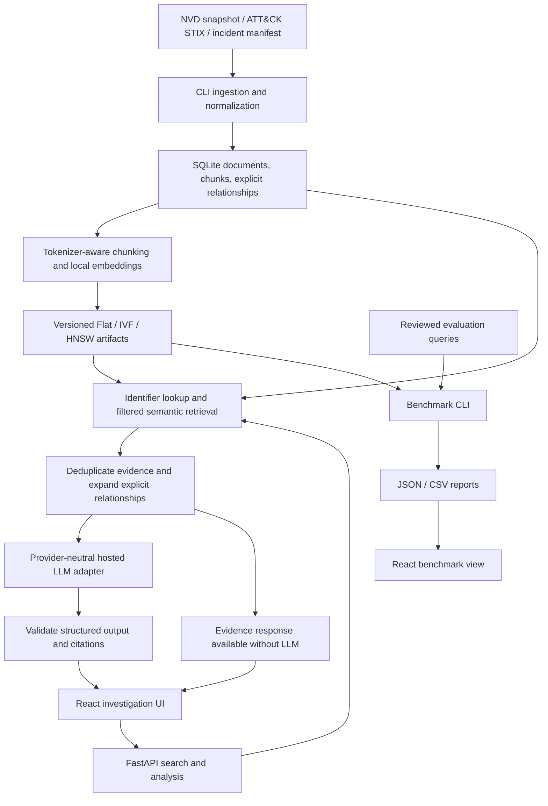

# ThreatVector build guide

This is the main architecture and implementation reference. `Requirements.md` defines acceptance criteria; `AGENTS.md` governs agent work; `Progress.md` records actual delivery state. This file describes intended behavior, not completed implementation.

Product focus (2026-10-15): center semantic vulnerability correlation, hybrid retrieval, evidence-grounded explanations, and FAISS indexing. Hybrid retrieval means exact CVE/ATT&CK lookup supplemented by semantic vector results in the existing design; adding lexical/BM25 ranking requires a separate scope decision. Public incident reports are supporting correlation evidence. Do not add generic log monitoring, incident dashboards, alert feeds, or SIEM workflows. Frontend priorities are the correlation question, retrieved evidence, source-supported versus inferred associations, cited explanations, and reproducible Flat/IVF/HNSW comparisons.

## Architecture flow

## Components and storage

- **Frontend:** React, TypeScript, Vite, and Recharts. Investigation view shows query controls, ranked evidence, explanations, related entities, and mitigations. Evidence detail shows stored excerpts, metadata, and original links. Benchmark view compares actual quality, latency, and memory measurements.
- **Backend:** FastAPI with Pydantic validation; separate ingestion, embedding, index, retrieval, correlation, generation, and evaluation modules. Use pytest for backend checks and Vitest plus React Testing Library for meaningful UI behavior checks.
- **Metadata:** SQLite stores documents, chunks, and explicit relationships. Documents retain stable internal IDs, source type, source ID, title, URL, publication date when known, retrieval date, and content hash. Chunks retain document ID, ordinal, text, and token offsets. Relationships retain endpoints, relationship type, and the supporting source/chunk reference.
- **Artifacts:** Local data directories hold source snapshots, embeddings, indexes, manifests, and reports. Each index manifest records corpus/chunk hashes, model revision, vector dimension, metric, parameters, seed, and library versions. Write a new artifact set before making it active; never mix index generations.
- **Repository layout:** `backend/` contains Python services and CLI; `frontend/` contains the browser app; `data/` holds ignored local artifacts and separately tracked permitted fixtures/manifests; `evaluation/` holds reviewed questions and reports. Add a README, environment example, dependency locks, and ignore rules during scaffolding.

## Data and retrieval design

1. Ingest NVD CVE records from a bounded, recorded snapshot, a pinned MITRE Enterprise ATT&CK STIX release, and incident URLs listed in an explicit manifest. Select CVEs deterministically and record the selection in the manifest. Preserve raw source hashes; use pagination, bounded retries, and source rate-limit handling. Never silently substitute fixtures for a failed full import.

   Seed-only milestone (2026-10-15): `data/fixtures/corpus.json` contains six manually curated, attributed documents using original factual summaries, with exact source locators and five explicit relationships. `data/manifests/fixture-v1.json` freezes their hashes; `data/fixtures/SOURCE_REVIEW.md` records reuse decisions. ATT&CK release 17.1 is pinned to commit `dc2ea9270f1a91398c750a6dceb3591b86082ce8` for this seed. Sections are curated evidence units, not tokenizer-generated chunks or raw provider-schema normalization fixtures. Original CISA report prose is not cleared for redistribution. User requested fixtures/source review only at this milestone; ingestion and application integration remain separate future work.

   Policy follow-up (2026-10-15): source-review manifest revision 2 records final source-specific categories: full text, excerpts/summaries only, metadata/links only or excluded. NVD API/bulk policy content has now been verified in the rendered official pages; see `data/fixtures/NVD_API_POLICY.md`. Future acquisition must honor 5/50 requests per rolling 30 seconds without/with a key, recommended six-second spacing, shared-proxy limits, default-page pagination and key confidentiality. Feed META hashes cover uncompressed bytes. No scheduled refresh is authorized. Project summaries must be attributed to ThreatVector with original-record provenance separate, in accordance with the NVD modified-content rule. Current CISA terms are accessible but do not establish worldwide full-report permission; summaries only remain the approved project representation. Microsoft candidates are metadata/link-only; the NCSC-authored candidate article is eligible under OGL v3.0 with stated exclusions, while its separately linked advisory is excluded pending independent review. Candidate eligibility does not add data to the fixture.
2. Normalize source-specific records, preserve ATT&CK relationships and explicit incident mentions of CVEs/techniques, and deduplicate by stable source identity and content hash. Exclude revoked/deprecated ATT&CK objects from active retrieval while preserving their provenance if referenced.

   Normalization milestone (2026-10-15): pure adapters in `backend/normalization/` accept NVD API 2.0, selected STIX object types/relationships and project-defined incident-summary manifests. Raw fixtures are separately hashed in `data/manifests/raw-normalizers-v1.json`; unmodified NVD response text includes NIST/CVE notices, STIX subset objects retain the pinned MITRE license, and CISA prose remains excluded. Input snapshot/record/section hashes and JSON/PDF source locators survive normalization. Same-identity/content duplicates merge provenance; conflicting revisions raise rather than silently overwrite. Inactive records are retained but marked inactive, missing STIX endpoints produce explicit inactive relationships/issues, and mentions never imply exploitation. Stronger incident annotations require trusted-caller review opt-in. Legacy deprecated mitigations using T-number references retain STIX identity to avoid active-technique collisions. No tokenizer chunking, persistence, ingestion CLI, API acquisition or application wiring is implemented by this milestone.
3. Use `sentence-transformers/all-MiniLM-L6-v2`, pinned to a verified revision. Chunk source sections into at most 220 model tokens with 30-token overlap, including any embedded title/metadata text within that limit. Produce normalized float32 embeddings locally on CPU. The model emits 384-dimensional vectors and truncates inputs above its documented limit: [model card](https://huggingface.co/sentence-transformers/all-MiniLM-L6-v2).

   Chunk/model milestone (2026-10-16): immutable revision `1110a243fdf4706b3f48f1d95db1a4f5529b4d41` is frozen with asset byte hashes in `backend/embedding-model.json`. `backend/chunking.py` uses its fast tokenizer, counts prefix and special tokens within 220, overlaps 30 section-body tokens and preserves exact character/token offsets. SQLite chunk generations are atomic and hash-bound to the corpus. `backend/CHUNKING.md` documents optional CPU dependencies and explicit local verification; bulk corpus embeddings, indexes and retrieval remain later work. The model's Sentence Transformers limit is 256 tokens, distinct from the base BERT position limit of 512.
4. Construct FAISS `IndexFlatIP`, `IndexIVFFlat`, and `IndexHNSWFlat` with inner product. Flat is the default and exact comparison baseline. See [FAISS index documentation](https://github.com/facebookresearch/faiss/wiki/Faiss-indexes).

   Index milestone (2026-10-16): `backend/vector_artifacts.py` creates CPU embedding snapshots from validated SQLite chunks. `backend/indexes.py` builds all three strategies and source-type partitions from the same normalized float32 vectors. It checks file hashes before native reload, validates metadata/parameters and exact reconstructed vectors, compares pre/post-persistence searches and atomically publishes a manifest-pinned active generation. Undertrained IVF partitions are explicitly skipped (39 training vectors per centroid); no silent fallback. The optional FAISS CPU dependency is pinned to 1.10.0. See `backend/INDEXES.md` and Progress.md for commands, measured checks and remaining retrieval work.
5. Build full-corpus indexes and source-type partitions. For multiple selected source types, search each selected partition and merge by comparable similarity score. Exact identifier matches precede semantic supplementation; deduplicate by chunk ID. Cap requests at 50 search results, defaulting to 10.

   Filter milestone (2026-10-16): `backend/retrieval.py` implements full-corpus and selected-partition semantic search with one query embedding, raw inner-product candidate merging, chunk-ID deduplication and a global top-k cap. None selects the full index; an explicit empty list selects nothing. Unavailable nonempty strategies fail explicitly. A persistent local query-embedding worker isolates Torch/FAISS OpenMP runtimes on Windows; unsafe duplicate-runtime flags are not used. CLI commands and measured filter/traceability checks are documented in `backend/RETRIEVAL.md`. Exact identifiers and HTTP integration remain incomplete.

   Safeguards milestone (2026-10-16): shared top-k constants enforce default 10 and maximum 50 at CLI/service/native boundaries. Deduplication preserves each chunk's highest original score and retains separate chunks from one document. Evidence responses preserve provenance, source/reuse metadata and source/token offsets. Typed manifests and complete artifact inventories are validated before native loading; malformed, mismatched or incomplete generations raise `IndexValidationError`. Evidence snapshots reject missing/duplicate chunks and inconsistent source joins. See `backend.verify_safeguards` and its measured report for live checks.
6. Expand explicit source relationships and retrieve their supporting chunks for analysis. Keep semantic associations labeled as inferred. Do not infer that a CVE was used in an incident merely because texts are similar.
7. Use up to eight deduplicated chunks for generation, prioritizing direct identifier evidence and supported relationships. Return insufficient evidence when nothing relevant survives a threshold calibrated on tuning queries; freeze that threshold before held-out evaluation. Do not interpret similarity scores as probabilities.

### SQLite and full-corpus milestone (2026-10-15)

Phase 1 now has transactional SQLite storage, hash-verified offline ingestion, bounded bulk acquisition, immutable-revision conflict handling and persistent zero-write replay checks. See `backend/CORPUS.md` for commands. The local full-v1 corpus contains 10,000 deterministically selected 2021 NVD records, the pinned Enterprise ATT&CK 17.1 bundle (2,091 normalized records) and 20 original incident-report summaries. Frozen manifests and the actual validation report are under `data/manifests/`; downloaded snapshots and the SQLite database remain ignored. Exact replay requires archived bytes because upstream feeds/pages change.

SQLite retains documents, evidence sections, explicit relationships, provenance, diagnostics and import receipts. Conflicting same-identity revisions abort the entire import; updated corpora use a separate database. Inactive records and unresolved endpoints are retained explicitly. The reserved chunks table was empty at this phase-1 milestone; phase-2 chunk construction is documented above. Ingestion and storage are CLI services; the HTTP foundation and frontend remain unwired. Earlier fixture/normalizer milestone descriptions above are historical, not current missing-work claims.

Phase-1 closure audit (2026-10-15): the earlier v1 completion claim omitted 148 ATT&CK metadata entities. Current `full-corpus-v2.json` selects `enterprise_complete_v1`, adding data sources, data components and the matrix. It contains 2,239 ATT&CK records and resolves all 20,411 STIX relationship endpoints. Source bytes and frozen v1 artifacts are unchanged. The v2 database has 10,000 CVEs and 20 incident summaries; five out-of-sample incident CVE mentions stay unresolved. `backend/PHASE1_ACCEPTANCE.md` maps every phase-1 deliverable/exit criterion to verified checks, including raw-pointer replay, notice hashes, SQL integrity and zero-write idempotence. Phase 1 is complete; phase-2 progress is documented above and application integration remains later work.

## API and generation contract

| Interface | Behavior |
| --- | --- |
| `GET /health` | Report service readiness, corpus/index availability, and provider configuration without revealing secrets. |
| `GET /corpus` | Return source counts, snapshot identity, and active artifact metadata. |
| `POST /search` | Accept `query`, `index` (`flat`, `ivf`, `hnsw`), `source_types`, and `top_k`; return ranked chunks, metadata, scores, and retrieval timing. |
| `POST /analyze` | Accept query, index, and source types; return status, cited claims, related entities, mitigations, evidence, and timing. |
| `GET /documents/{id}` | Return stored document metadata and chunks; return 404 for unknown IDs. |
| `GET /benchmarks` | Return saved benchmark runs and metrics; do not run expensive experiments inside an HTTP request. |

Validate nonblank queries with a 2,000-character cap and reject unknown enum values. Bind services to localhost and allow only the local frontend origin by default.

The provider interface is `generate(messages, response_schema)`. Implement a configurable OpenAI-compatible chat adapter with server-side endpoint, model, key, and a 60-second timeout. Provider-specific differences stay inside the adapter; provider-neutral does not mean every endpoint supports identical capabilities.

Require a structured response containing claims, related techniques/entities, mitigations, citation chunk IDs, and uncertainty. Every displayed factual claim and mitigation must have supporting evidence; explicitly labeled inference must also identify its basis. Validate response shape, citation membership in supplied context, and ATT&CK identifiers against the corpus. Retry invalid structured output once, then return evidence with a generation-error status. Missing credentials and timeouts also return evidence. Never replace failures with fabricated explanations.

Retrieved text is delimited untrusted evidence. It cannot set system instructions, request secret disclosure, or authorize tools. Generation has no tool execution capability. Validate traceability programmatically; assess actual entailment through answer evaluation.

## Benchmark protocol

- Use the same full-corpus embeddings and held-out queries for all indexes; keep filtered and identifier-assisted application results outside the ANN comparison.
- Sweep IVF `nlist=64/128/256` and `nprobe=1/4/16/32`; skip undertrained configurations with an explicit reason. Require at least 39 training vectors per centroid. Train with a fixed seed and a deterministic sample of up to 100,000 corpus vectors.
- User-directed incident exception (2026-10-16): build incident-only IVF with `nlist=1`, `nprobe=1` and a one-vector-per-centroid training minimum, so the 22 incident vectors can train. Record the effective parameters, reduced training minimum, `incident_single_list` profile and benchmark exclusion in each schema-2 manifest. This retrieval-only exception is excluded from standard `nlist=64/128/256` comparisons; other partitions retain the 39-per-centroid guard. Empty partitions still skip. Single-list IVF scans the complete incident subset and makes no ANN speed/quality claim.
- Sweep HNSW `M=16/32`, `efSearch=16/64/128`, and `efConstruction=200`. Record build and search parameters independently.
- Fix seed 42 and use one FAISS search thread for the baseline. Warm up searches, then execute five timed passes; record hardware and versions. Embed queries before measuring index latency.
- Report recall@10 versus Flat, document-level relevance recall@10 and MRR from reviewed labels, p50/p95 latency, build duration, serialized bytes, and peak process memory from isolated workers. Memory includes process overhead and must be labeled accordingly.
- Split 60 reviewed questions into 30 tuning and 30 held-out questions. Tune thresholds/parameters only on the tuning split. Leave held-out labels out of retrieval input. Include unsupported cases in answer evaluation and report them separately from positive relevance metrics.
- Export JSON and CSV with query-set hash, corpus hash, model revision, configuration, and measured results. Manual answer review covers 20 held-out questions and records evidence support, technique correctness, and mitigation relevance.

## Build phases and exit criteria

User-directed scope adjustment (2026-10-15): build the demo front page and actual React/TypeScript frontend first, with a minimal backend foundation. Interface code may precede phases 1–3 under this instruction, but phase 4 remains incomplete until the real API/browser workflow is verified. Demo content is explicitly synthetic; benchmark charts consume saved live results only. Frontend response field shapes are documented in `frontend/src/api.ts` and README.md for subsequent backend integration.

| Phase | Deliverables | Exit criteria |
| --- | --- | --- |
| 0 — Foundation | Backend/frontend scaffolds, locks, configuration, ignore rules, README | Backend imports, health endpoint works, frontend type/build checks pass, no secrets committed. |
| 1 — Corpus | Normalizers, SQLite schema, permitted fixtures, full-data manifests, ingestion CLI | Repeated imports are idempotent; source metadata and explicit relationships survive; full target corpus is available or limitation remains open. |
| 2 — Retrieval | Chunker, embedder, artifact manifests, three index strategies, filtered search | Chunk/token limits pass; index reload is stable; mismatched artifacts are rejected; identifier and filter cases pass. |
| 3 — Analysis | Correlation service, provider adapter, structured output and citation validation | Mocked grounded/unsupported/conflicting/injection/error cases pass; retrieval survives provider failures. |
| 4 — Interface | Investigation, evidence detail, and benchmark views | Browser workflow works; citations open matching evidence; loading, empty, and failure states are usable. |
| 5 — Evaluation | Reviewed questions, benchmark CLI, exports, answer rubric/results | Real runs are reproducible, tuning/held-out split is respected, charts reflect exported values. |
| 6 — Delivery | Windows setup guide, samples, final checks, limitations, live-provider smoke record | Clean setup and end-to-end path verified; backend tests/frontend checks pass; all unverified work is disclosed. |

Implement a fixture-based vertical slice first, then scale to the full corpus and finish evaluation. Do not mark later phases complete solely because the fixture demo works.

## Verification and limits

Test source normalization and deduplication, chunk boundaries, provenance, index persistence, manifest mismatch rejection, exact IDs, filtered search, relationship evidence, invalid citations, conflicting evidence, unsupported questions, prompt injection, missing keys, and provider timeouts. UI checks cover evidence navigation and visible failure states. Verify one full ingestion-to-answer workflow and compare chart values with saved metrics.

Public sources may omit mappings or conflict. The general-purpose embedder may miss security-specific language. Citation validation cannot prove semantic support. Small corpora may favor Flat; CPU, network, and provider performance vary. Report these limits and actual findings in `Progress.md` and delivery documentation.
